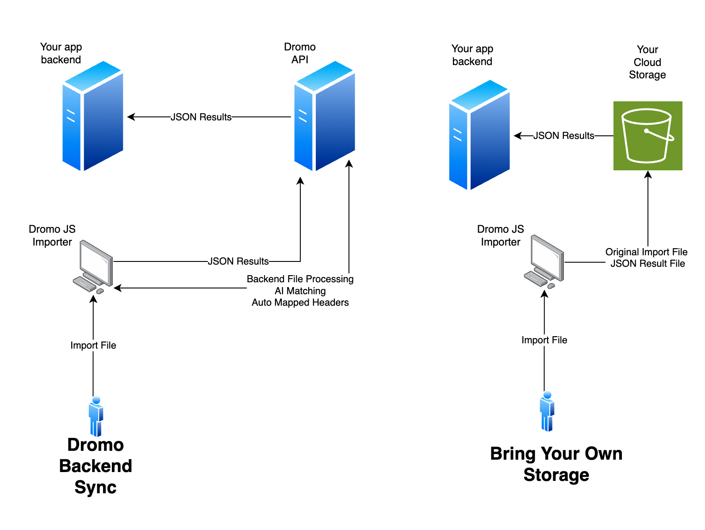

Bring Your Own Storage (BYOS) allows import data to be sent from the Dromo JS widget in your user's browser directly to your cloud storage bucket, without Dromo ever having access to the data.

<Info>
  BYOS is only available on the Enterprise Plan.
</Info>

## BYOS Requirements and Setup[​](#byos-requirements-and-setup "Direct link to BYOS Requirements and Setup")

BYOS supports AWS S3, GCP Cloud Storage, and Azure Blob Storage. You will need to have configuration access to prepare your storage layer for receiving data from Dromo. Dromo will need **write-only** access, which will be used to generate pre-signed upload URLS used by the Dromo importer widget.

BYOS is enabled for your organization by Dromo. Once it is, organization admins manage the storage settings themselves in the dashboard, so credentials never need to be sent to Dromo staff.

## Managing Storage in the Dashboard[​](#managing-storage-in-the-dashboard "Direct link to Managing Storage in the Dashboard")

Organization admins find the settings under **My organization → Storage** in the [Dromo dashboard](https://dashboard.dromo.io). Choose how Dromo connects to your storage and fill in the settings it asks for:

| Storage | Settings |
|---|---|
| Amazon S3 (access key) | Bucket, region, access key ID, secret access key |
| Amazon S3 (IAM role) | Bucket, region, role ARN, and an external ID if the role's trust policy requires one |
| Azure (account key) | Container, storage account name, account key |
| Azure (SAS token) | Container, storage account name, and a container SAS token with Create and Write permissions only |
| Google Cloud Storage | Bucket and the service account's JSON key |

Turn on **Write-only access** if the credentials can add files but not read them. It is always on with an Azure SAS token.

When you click **Save**, Dromo first writes a small test file to your storage with the new settings, under `dromo-connection-test/`, and deletes it again. The settings are saved only if that write succeeds; otherwise you see your storage provider's error and the previous settings stay in use. With write-only access Dromo can't delete the test file, so it stays in your bucket and is safe to remove.

Secrets are stored encrypted and are never shown again, in the dashboard or to Dromo staff.

### Rotating Keys[​](#rotating-keys "Direct link to Rotating Keys")

To rotate a key without interrupting imports:

<Steps>
  <Step title="Create the new key">
    Create the new access key, account key, SAS token or service account key with your cloud provider. Leave the old one active.
  </Step>
  <Step title="Save it in Dromo">
    Under **My organization → Storage**, enter the new key in its field and click **Save**. Fields you leave blank keep their saved value. Dromo switches to the new key as soon as the test write succeeds.
  </Step>
  <Step title="Revoke the old key">
    Use **Test connection** to confirm Dromo can still write to your storage, then revoke the old key with your cloud provider.
  </Step>
</Steps>

<Warning>
  Changing the bucket, container or storage provider only affects new imports. Files from earlier imports stay where they are, and Dromo no longer finds them unless you copy them to the new location.
</Warning>

To stop using BYOS altogether, contact Dromo support.

## Using BYOS[​](#using-byos "Direct link to Using BYOS")

Once configured, ensure [`settings: backendSycMode`](/reference/settings/settings#backendsyncmode) is set to `"FULL_DATA"`. All your imports will automatically be uploaded to the bucket associated with the account the API key belongs to. The raw import file will also be saved to your bucket.

After the import is completed, Dromo's backend will send any configured webhooks for the import. You can also retrieve the metadata for any import using the [Get Upload Metadata API endpoint](/api-reference#tag/uploads/operation/getUploadMetadata).
